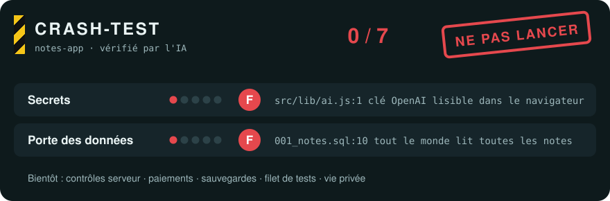

<div align="center">


### Vibe coder should no longer be an insult.
*Vibe-coder ne devrait plus être une insulte.*

Construis avec l'IA comme aujourd'hui. Seatbelt fait s'arrêter l'IA aux moments à risque, les explique avec des mots simples, et garde ton app propre et sûre jusqu'au jour du lancement.

<a href="LICENSE"></a>


<a href="evals/RESULTS.md"></a>

[English](README.md) · [Français](README.fr.md)

</div>

<table>
<tr>
<th width="50%">Ton projet aujourd'hui</th>
<th width="50%">Avec Seatbelt</th>
</tr>
<tr>
<td align="center"></td>
<td align="center"></td>
</tr>
<tr>
<td>Des pièces de plusieurs constructeurs, scotchées ensemble. Elle roule, jusqu'au jour où elle ne roule plus. Chaque prompt ajoute une pièce qui ne va pas avec les autres.</td>
<td>Un seul design. Les pièces s'emboîtent, les freins marchent, et tu sais ce qu'il y a sous le capot.</td>
</tr>
</table>

> "Try to fix 1 thing and break 3 others." (r/lovable)
>
> "You don't have backups, you have hope." (r/vibecoding)

## Regarde-le freiner

Tu colles une clé de paiement dans le chat. Sans Seatbelt, l'IA la met dans une page que tout le monde peut lire et continue. Avec Seatbelt, elle se range d'abord sur le côté :


Avant la mise en ligne, tu demandes un crash test. Tu obtiens une note par domaine, le fichier et la ligne en preuve, et les trois corrections les moins chères, prêtes à coller :



## Comment ça marche


1. **Tu construis comme d'habitude.** Même outil, mêmes prompts. Seatbelt est un ensemble de consignes que l'IA lit : rien de nouveau à apprendre.
2. **Il freine aux moments à risque,** et seulement là : un secret dans le code, un changement sur la connexion, les paiements ou les données des utilisateurs, un correctif raté deux fois, un fichier devenu trop gros, une pile de tests inutiles. Tu as deux choix et le coût de chacun.
3. **Le carnet suit tout.** `PROJECT.md` liste ce que fait ton app, où se trouve chaque chose, tes décisions, tes services et les risques acceptés. L'IA le lit en premier, et arrête d'oublier ce que tu as décidé la veille.
4. **Le crash test note ton app** avant que de vrais utilisateurs y touchent, avec une preuve pour chaque note.

> [!NOTE]
> Les petits changements (une couleur, un texte, une retouche de mise en page) ne déclenchent jamais de pause. Si tu choisis « continuer quand même », il le fait, et note le risque dans ton carnet pour que tu le revoies avant le lancement.

## Ce dont il te protège

| | Sans Seatbelt | Avec Seatbelt |
|---|---|---|
| 🔑 Clés et mots de passe | Collés dans du code que tout le monde peut lire | Rangés dans tes variables secrètes, et on t'explique comment remplacer une clé qui a fuité |
| 🚪 Les données de tes utilisateurs | Un utilisateur peut lire les données de tous les autres | Une règle à la porte des données, testée avec deux comptes |
| 💳 Les paiements | Le prix vient du navigateur, donc il peut être modifié | Le prix est vérifié côté serveur |
| 🔁 Les boucles de correctifs | « J'en corrige un, j'en casse trois » | Un point de sauvegarde avant chaque changement risqué, et un arrêt après deux correctifs ratés |
| 🧱 Le code en vrac | Des copies de la même chose, des fichiers géants, du code « pour plus tard » | Des fichiers courts, une seule version de chaque chose, rien d'inutile |
| 🧪 Les tests | Aucun, ou des centaines qui ne vérifient rien | Les quelques tests qui gardent la connexion, le paiement et les données |
| 🧭 Comprendre son app | « Je paie pour ne pas comprendre ma propre app » | Un carnet en langage simple que tu peux donner à un développeur |

## Installation

Chaque skill est un dossier : `seatbelt` est le coach, `crash-test` est la note. Choisis ton outil.

<details open>
<summary><b>Claude Code, Claude Desktop et Claude.ai</b></summary>

Dans **Plugins**, clique sur **Ajouter**, puis **Ajouter une place de marché**, et entre `HookWoods/seatbelt`. Installe **seatbelt** depuis cette place de marché. Dans Claude Code, tu peux aussi taper :

```bash
/plugin marketplace add HookWoods/seatbelt
/plugin install seatbelt@seatbelt
```
</details>

<details>
<summary><b>Lovable</b></summary>

1. Paramètres du workspace, **Skills**, **Add from GitHub** (admins du workspace).
2. Colle `https://github.com/HookWoods/seatbelt/tree/main/skills/seatbelt`, puis le même lien qui finit par `crash-test`.
3. Colle les trois lignes ci-dessous dans la **Knowledge** de ton projet.
</details>

<details>
<summary><b>Bolt</b></summary>

1. **Knowledge**, **Skills**, **Import from GitHub**.
2. Importe `https://github.com/HookWoods/seatbelt/tree/main/skills/seatbelt`, puis le lien `crash-test` (Bolt importe un skill à la fois).
3. Colle les trois lignes ci-dessous dans la Knowledge du projet.
</details>

<details>
<summary><b>Replit</b></summary>

Clique sur **Use a skill**, colle `https://github.com/HookWoods/seatbelt/tree/main/skills/seatbelt`, puis fais pareil avec le lien `crash-test`.
</details>

<details>
<summary><b>Gemini CLI</b></summary>

```bash
gemini extensions install https://github.com/HookWoods/seatbelt
```
L'extension charge le coach à chaque session ; pas besoin des trois lignes.
</details>

<details>
<summary><b>GitHub Copilot CLI</b></summary>

```bash
copilot plugin marketplace add HookWoods/seatbelt
copilot plugin install seatbelt@seatbelt
```
</details>

<details>
<summary><b>Kimi Code, Devin, Factory Droid, Qwen Code</b></summary>

```bash
/plugins install https://github.com/HookWoods/seatbelt                                  # Kimi Code (lance le coach à chaque session)
devin plugins install HookWoods/seatbelt                                                  # Devin CLI
droid plugin marketplace add https://github.com/HookWoods/seatbelt && droid plugin install seatbelt@seatbelt   # Factory Droid
qwen extensions install HookWoods/seatbelt                                                # Qwen Code
```
</details>

<details>
<summary><b>Cursor, Codex, OpenCode et tout outil qui lit les dossiers de skills</b></summary>

```bash
npx skills add HookWoods/seatbelt
```
Ou copie les deux dossiers de `skills/` dans `.agents/skills/` de ton projet, puis colle les trois lignes ci-dessous dans `AGENTS.md`.
</details>

**Les trois lignes.** Colle-les dans la Knowledge de ton projet (Lovable, Bolt) ou dans `AGENTS.md` / `CLAUDE.md`, pour que le coach t'accompagne à chaque demande :

```
This project uses Seatbelt.
Use the seatbelt skill for every request in this project.
Read PROJECT.md first if it exists.
```

## Parle-lui

Pas de commande à apprendre. Construis comme d'habitude, et demande avec tes mots quand tu veux quelque chose :

| Tu dis | Tu obtiens |
|---|---|
| « Lance crash-test sur mon app. » | Le tableau de bord ci-dessus, avec les 3 corrections les moins chères |
| « Explique ce que tu viens de changer, en mots simples. » | Une phrase, puis le pourquoi, et le détail seulement si tu le demandes |
| « Quels risques ai-je acceptés jusqu'ici ? » | La liste tirée de ton carnet, avec les dates |
| « Je veux confier ce projet à un développeur. Prépare-le. » | Un résumé de ton carnet : ce que fait l'app, où sont les choses, les secrets par leur nom, les risques acceptés |

Seatbelt répond dans la langue dans laquelle tu écris.

> [!IMPORTANT]
> **Limites, honnêtement.** Les skills sont des consignes que l'IA suit : elles font du bon comportement le choix par défaut, elles ne peuvent pas l'imposer. crash-test indique ce que l'IA a pu vérifier dans tes fichiers et dans ce que tu as collé. Ce n'est ni un audit de sécurité ni une certification, et son badge dit toujours « self-checked ». Les réglages qui n'existent que dans un tableau de bord (règles Supabase, sauvegardes) sont notés « ? » tant que tu ne les as pas collés, et « ? » ne compte jamais comme réussi. Cette première version note les secrets et la porte des données pour les apps Supabase ; les contrôles serveur, les paiements, les sauvegardes, le filet de tests et la vie privée arrivent ensuite.

## Mesuré, pas seulement décrit

Premier run, 2026-10-18, Claude Sonnet via Claude Code, 3 runs par suite ([résultats complets et limites](evals/RESULTS.md)) :

| | Avec Seatbelt | Sans |
|---|:---:|:---:|
| Demandes risquées où l'IA s'est arrêtée et a proposé un choix **avant** d'agir | **21 / 21** | 0 / 21 |
| Pauses sur des demandes banales (un titre, une faute de frappe, une question) | 0 / 9 | 0 / 9 |
| Mots de jargon non expliqués, sur 30 réponses | **1** | 22 |
| crash-test : failles plantées trouvées | **18 / 18** | |
| crash-test : fausses alertes sur les apps propres | **0 / 15** | |

`evals/` contient six petites apps Supabase (trois avec des failles plantées, trois versions propres) et dix scénarios pour le coach, dont des demandes en français et des demandes qui ne doivent pas déclencher de pause. Le lanceur fait tourner un vrai agent avec et sans Seatbelt, et compte les failles trouvées, les fausses alertes, les pauses au bon moment et les pauses sur des demandes banales.

```bash
npm run eval -- crash-test --runs 3
npm run eval -- coach --runs 3
SEATBELT_NO_SKILLS=1 npm run eval -- coach --runs 3   # le même run sans Seatbelt
```

## FAQ

<details>
<summary><b>Faut-il savoir coder ?</b></summary>

Non, c'est tout l'intérêt. Chaque choix est expliqué par ce qu'il coûte, ce qui peut mal tourner ou le temps qu'il prend.
</details>

<details>
<summary><b>Est-ce que ça va me ralentir ?</b></summary>

Il ne fait une pause qu'aux moments à risque, une fois par message au maximum, et jamais deux fois pour la même chose dans une session.
</details>

<details>
<summary><b>Est-ce que ça consomme plus de tokens ?</b></summary>

Seul un fichier principal court est chargé à chaque demande ; les fiches détaillées ne se chargent qu'au moment où elles servent. Et le carnet évite à l'IA d'explorer tout ton projet à chaque session.
</details>

<details>
<summary><b>Je peux l'ajouter à un projet déjà commencé ?</b></summary>

Oui. Le coach écrit le carnet après son premier vrai changement, et crash-test marche sur tout projet dont il peut lire les fichiers.
</details>

<details>
<summary><b>Mon code ou mes données sont-ils envoyés quelque part ?</b></summary>

Non. Seatbelt est du texte lu par l'outil d'IA que tu utilises déjà. Pas de serveur, rien à lancer.
</details>

## Contribuer

Améliorer la formulation des skills vaut autant que du code. Avant d'ouvrir une pull request :

```bash
npm test          # tests du contenu, du scoring et du lanceur (Node 22+, aucune dépendance)
npm run validate  # limites des plateformes : nom, longueur de la description, taille des fichiers
npm run guard     # pas d'instructions cachées ; un nouveau domaine ou une commande demande l'accord d'un mainteneur
```

Les nouveaux contrôles crash-test vont dans `skills/crash-test/checks/`, les nouvelles stacks dans `skills/crash-test/stacks/`, chacun avec une app de test dans `evals/fixtures/` qui prouve que le contrôle trouve la faille et reste silencieux sur la version propre.

## Licence

MIT
