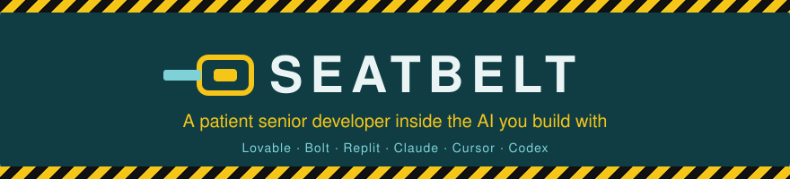
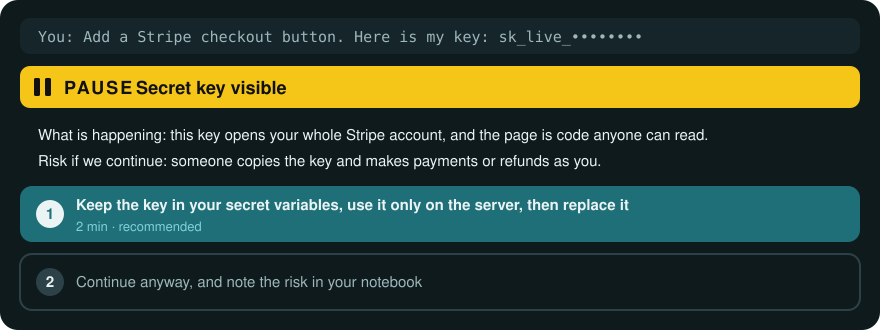
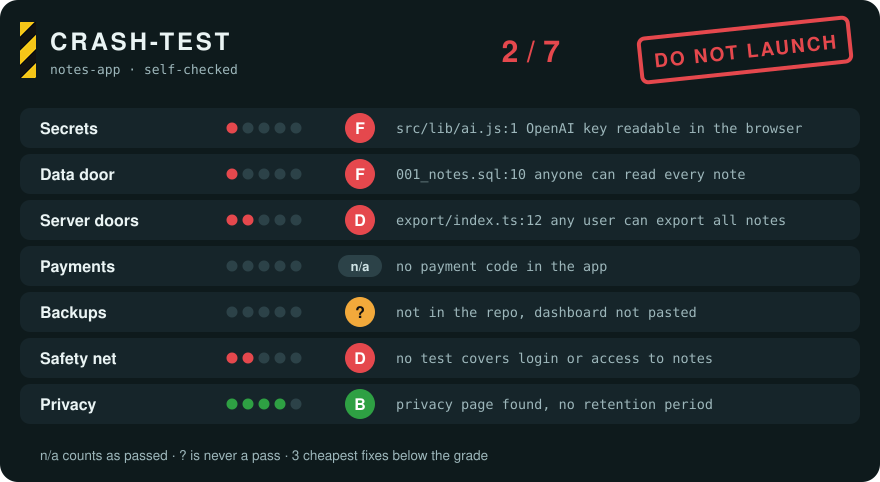
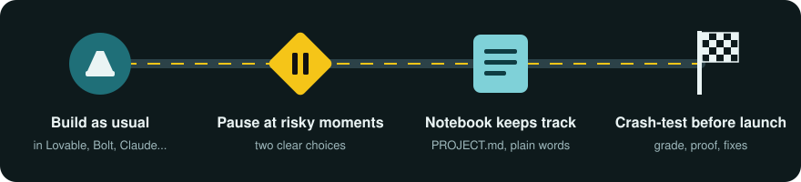

<div align="center">



### Vibe coder should no longer be an insult.

Build with AI like you do today. Seatbelt makes the AI stop at the risky moments, explain them in plain words, and keep your app clean and safe until launch day.

<a href="LICENSE"></a>


<a href="evals/RESULTS.md"></a>

[English](README.md) · [Français](README.fr.md)

</div>

<table>
<tr>
<th width="50%">Your project today</th>
<th width="50%">With Seatbelt</th>
</tr>
<tr>
<td align="center"></td>
<td align="center"></td>
</tr>
<tr>
<td>Parts from different makers, taped together. It drives, until it doesn't. Every prompt adds a part that does not match the others.</td>
<td>One design. The parts fit, the brakes work, and you know what is under the hood.</td>
</tr>
</table>

> "Try to fix 1 thing and break 3 others." (r/lovable)
>
> "You don't have backups, you have hope." (r/vibecoding)

## Watch it brake

You paste a payment key in the chat. Without Seatbelt, the AI drops it into a page anyone can read and moves on. With Seatbelt, it pulls over first:



Before you launch, you ask for a crash test. You get a grade per area, the file and line as proof, and the three cheapest fixes, ready to paste:



## How it works



1. **You build as usual.** Same tool, same prompts. Seatbelt is a set of instructions the AI reads, so there is nothing new to learn.
2. **It brakes at the risky moments,** and only there: a new app with no clear goal, a new service to sign up for, a secret in the code, a change to login, payments or users' data, a fix that failed twice, a file that grew too big, a pile of useless tests, a change that could erase your data, a feature that bills you per use, and launch day. You get two choices and the cost of each.
3. **The notebook keeps track.** `PROJECT.md` lists what your app does, where things are, your decisions, your services and the risks you accepted. The AI reads it first, so it stops forgetting yesterday.
4. **The crash test grades your app** before real users touch it, with proof for every grade.

> [!NOTE]
> Small changes (a color, a text, a layout tweak) never trigger a pause. If you choose "continue anyway", it does exactly that and writes the risk in your notebook so you can review it before launch.

## What it protects you from

| | Without Seatbelt | With Seatbelt |
|---|---|---|
| 🔑 Keys and passwords | Pasted into code anyone can read | Kept in your secret variables, a check that refuses any commit or push containing one, and how to replace a leaked one |
| 🚪 Your users' data | One user can read everyone else's data | A rule at the data door, tested with two accounts |
| 💳 Payments | The price comes from the browser, so it can be changed | The price is checked on the server |
| 🔁 Fix loops | "Fix one thing, break three others" | A save point before every risky change, and a stop after two failed fixes |
| 🧱 Messy code | Copies of the same thing, giant files, code "for later" | Small files, one version of each thing, nothing unused |
| 🧪 Tests | None, or hundreds that check nothing | The few tests that guard login, payment and data |
| 🗑️ Your stored data | "Delete that column" wipes months of data, and undo does not bring it back | A checked copy of the data first, then changes in steps you can undo |
| 💸 Surprise bills | An AI button with no limit runs up the bill overnight | The price per use up front, a spending cap and a limit per user |
| 🚀 Launch day | Live with test keys, no backups and no privacy page | A go-live list: blockers first, then what to fix before you tell many people |
| 🧭 Understanding | "I'm paying to not understand my own app" | A plain-language notebook you can hand to a developer |

## Install

Each skill is one folder: `seatbelt` is the coach, `crash-test` is the grade. Pick your tool.

<details open>
<summary><b>Claude Code, Claude Desktop and Claude.ai</b></summary>

In **Plugins**, click **Add**, then **Add a marketplace**, and enter `HookWoods/seatbelt`. Install **seatbelt** from it. In Claude Code you can also type:

```bash
/plugin marketplace add HookWoods/seatbelt
/plugin install seatbelt@seatbelt
```
</details>

<details>
<summary><b>Lovable</b></summary>

1. Workspace settings, **Skills**, **Add from GitHub** (workspace admins).
2. Paste `https://github.com/HookWoods/seatbelt/tree/main/skills/seatbelt`, then the same link ending in `crash-test`.
3. Paste the three lines below into your project **Knowledge**.
</details>

<details>
<summary><b>Bolt</b></summary>

1. **Knowledge**, **Skills**, **Import from GitHub**.
2. Import `https://github.com/HookWoods/seatbelt/tree/main/skills/seatbelt`, then the `crash-test` link (Bolt imports one skill at a time).
3. Paste the three lines below into your project Knowledge.
</details>

<details>
<summary><b>Replit</b></summary>

Click **Use a skill**, paste `https://github.com/HookWoods/seatbelt/tree/main/skills/seatbelt`, then do the same with the `crash-test` link.
</details>

<details>
<summary><b>Gemini CLI</b></summary>

```bash
gemini extensions install https://github.com/HookWoods/seatbelt
```
The extension loads the coach in every session; no need for the three lines.
</details>

<details>
<summary><b>GitHub Copilot CLI</b></summary>

```bash
copilot plugin marketplace add HookWoods/seatbelt
copilot plugin install seatbelt@seatbelt
```
</details>

<details>
<summary><b>Kimi Code, Devin, Factory Droid, Qwen Code</b></summary>

```bash
/plugins install https://github.com/HookWoods/seatbelt                                  # Kimi Code (starts every session with the coach)
devin plugins install HookWoods/seatbelt                                                  # Devin CLI
droid plugin marketplace add https://github.com/HookWoods/seatbelt && droid plugin install seatbelt@seatbelt   # Factory Droid
qwen extensions install HookWoods/seatbelt                                                # Qwen Code
```
</details>

<details>
<summary><b>Cursor, Codex, OpenCode and any tool that reads skill folders</b></summary>

```bash
npx skills add HookWoods/seatbelt
```
Or copy the two folders from `skills/` into `.agents/skills/` in your project, then paste the three lines below into `AGENTS.md`.
</details>

**The three lines.** Paste them into your project Knowledge (Lovable, Bolt) or into `AGENTS.md` / `CLAUDE.md`, so the coach rides along on every request:

```
This project uses Seatbelt.
Use the seatbelt skill for every request in this project.
Read PROJECT.md first if it exists.
```

## Talk to it

No commands to learn. Build as usual, and ask in your own words when you want something:

| You say | You get |
|---|---|
| "Run crash-test on my app." | The dashboard above, with the 3 cheapest fixes |
| "Explain what you just changed, in plain words." | One sentence, then the why, details only if you ask |
| "What risks did I accept so far?" | The list from your notebook, with dates |
| "I want to hand this to a developer. Prepare it." | A brief from your notebook: what the app does, where things are, secrets by name, accepted risks |

Seatbelt answers in the language you write in.

> [!IMPORTANT]
> **Honest limits.** Skills are instructions the AI follows: they make good behavior the default, they cannot force it. crash-test reports what the AI could verify in your files and in what you pasted. It is not a security audit or a certification, and its badge always says "self-checked". Settings that live only in a dashboard (Supabase rules, backups) are graded "?" until you paste them, and "?" never counts as a pass. This first version grades secrets and the data door for Supabase apps; server checks, payments, backups, a test safety net and privacy come next.

## Measured, not just described

Latest run, 2026-10-18, Claude Sonnet through Claude Code, 2 or 3 runs per scenario ([full results and limits](evals/RESULTS.md)):

| | With Seatbelt | Without |
|---|:---:|:---:|
| Risky requests where the AI stopped and offered a choice **before** acting | **30 / 30** | 0 / 45 |
| Pauses on requests that did not need one | 0 / 16 | 0 / 24 |
| First push: secret protection set up | **4 / 4** | 0 / 6 |
| Jargon words left unexplained | **6** in 46 answers | 52 in 63 answers |
| crash-test: planted flaws caught | **18 / 18** | |
| crash-test: false alarms on clean apps | **0 / 15** | |

`evals/` holds six small Supabase apps (three with planted flaws, three clean twins) and 23 coach scenarios covering every pause moment, including requests in French and requests that must not trigger a pause. The runner drives a real agent with and without Seatbelt and counts flaws caught, false alarms, pauses at the right moment and pauses on trivial requests.

```bash
npm run eval -- crash-test --runs 3
npm run eval -- coach --runs 2 --jobs 12   # about 2 minutes
SEATBELT_NO_SKILLS=1 npm run eval -- coach --runs 3   # the same run without Seatbelt
```

## FAQ

<details>
<summary><b>Do I need to know how to code?</b></summary>

No. That is the point. Every choice is explained by what it costs, what can go wrong or how long it takes.
</details>

<details>
<summary><b>Will it slow me down?</b></summary>

It pauses only at the risky moments, at most once per message, and never twice for the same thing in a session.
</details>

<details>
<summary><b>Does it cost more tokens?</b></summary>

Only a short main file is loaded on every request; the detailed sheets load when a moment needs them. The notebook also saves the AI from exploring your whole project at every session.
</details>

<details>
<summary><b>Can I add it to a project I already started?</b></summary>

Yes. The coach writes the notebook after its first real change, and crash-test works on any project whose files it can read.
</details>

<details>
<summary><b>Is my code or data sent anywhere?</b></summary>

No. Seatbelt is plain text read by the AI tool you already use. No server, nothing to run.
</details>

## Contributing

Better wording in the skills is worth as much as code. Before opening a pull request:

```bash
npm test          # content, scorer and runner tests (Node 22+, no dependencies)
npm run validate  # platform limits: name, description length, file sizes
npm run guard     # no hidden instructions; new domains or commands need a maintainer's approval
```

New crash-test checks go in `skills/crash-test/checks/`, new stacks in `skills/crash-test/stacks/`, each with a fixture app in `evals/fixtures/` that proves the check catches the flaw and stays quiet on a clean twin.

## License

MIT
